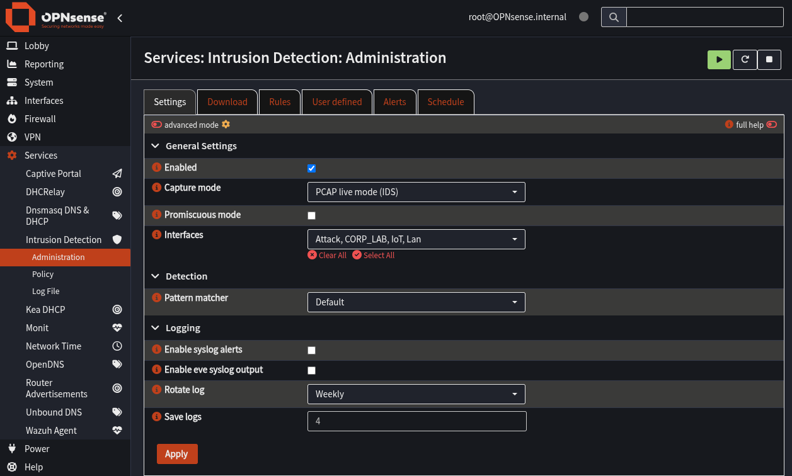
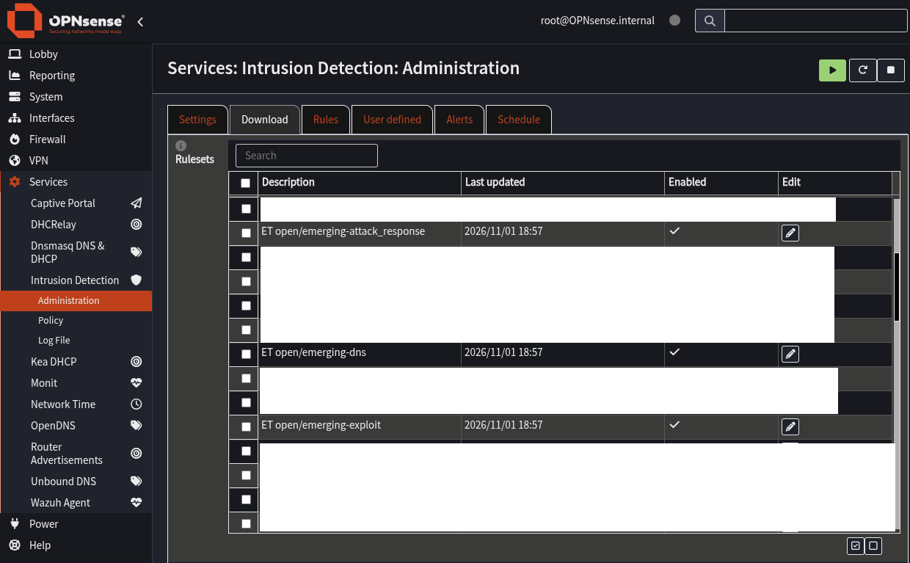
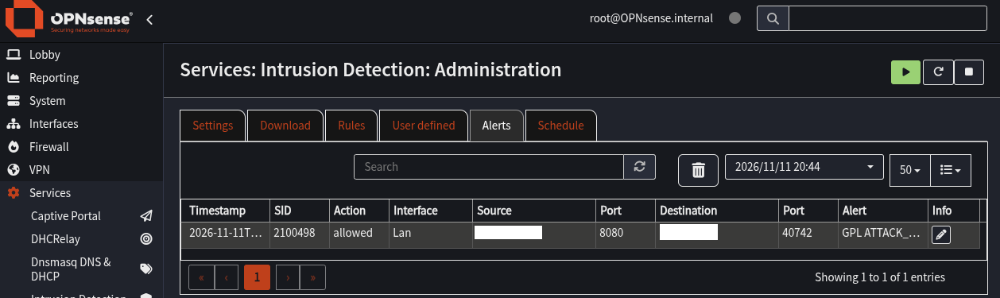
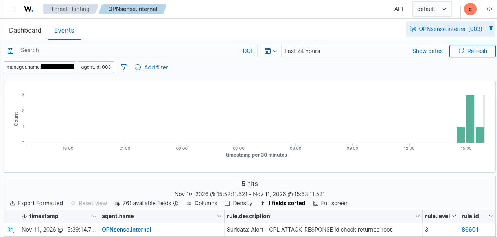

# Suricata + Wazuh | Network Threat Detection Lab

## Overview

I integrated Suricata IDS on my OPNsense firewall with a Wazuh SIEM running in my Proxmox homelab. The goal was to monitor traffic across segmented VLANs, detect suspicious activity with Emerging Threats signatures, and centralize alerts in Wazuh for investigation.

**Result:** I generated a controlled HTTP response that triggered Suricata signature **SID 2100498**. The alert appeared in OPNsense's EVE JSON log and in Wazuh under the OPNsense agent, confirming the end-to-end detection pipeline.

## Lab environment

| Component | Role |
| --- | --- |
| Proxmox VE | Virtualization platform |
| OPNsense 26.7.7 | Firewall and inter-VLAN routing |
| Suricata | Network intrusion detection (IDS) |
| Wazuh 4.14.9 | SIEM and alert investigation |
| Parrot OS | Controlled test traffic |
| Windows / Linux VMs | Segmented lab endpoints |

Suricata monitored the **Admin (VLAN 10), IoT (VLAN 20), Attack (VLAN 30), and Corporate Lab (VLAN 40)** interfaces. The WAN interface was excluded.

**Traffic and logging path:** `Lab traffic → OPNsense / Suricata → eve.json → Wazuh agent → Wazuh manager → Threat Hunting`

## Implementation

### 1. Configure Suricata on OPNsense

In **Services → Intrusion Detection → Administration → Settings**, I enabled Suricata in **PCAP live mode** and selected the four VLAN interfaces. I used IDS alerting rather than inline blocking, allowing me to observe detections without disrupting lab traffic.



### 2. Install and enable detection rules

From **Intrusion Detection → Administration → Download**, I downloaded and enabled relevant Emerging Threats rulesets, including:

- `emerging-scan`
- `emerging-exploit`
- `emerging-malware`
- `emerging-web_server`
- `emerging-attack_response`

I confirmed the installed rules configuration included `emerging-attack_response.rules` and that the test signature **SID 2100498** was enabled.



### 3. Connect OPNsense to Wazuh

I installed the OPNsense **`os-wazuh-agent`** plugin, configured its manager connection, and enrolled the firewall in Wazuh. The agent registered successfully as **`OPNsense.internal` (agent ID `003`)**.

I enabled **Intrusion detection events** in the agent settings and kept **Active response** disabled. The agent was configured to collect Suricata's JSON events from:

```text
/var/log/suricata/eve.json
```

The final verified ingestion path used this EVE JSON file; the extra EVE syslog output used during troubleshooting was disabled afterward.

### 4. Generate and verify a controlled detection

To test a specific enabled signature instead of relying on a generic port scan, I hosted a harmless text response containing the string that **SID 2100498** detects:

```text
uid=0 (root)
```

For the confirmed alert, Parrot served the response on a temporary Python HTTP server and OPNsense requested it. The HTTP response was visible to Suricata on VLAN 10 and generated:

```text
Signature ID: 2100498
Signature: GPL ATTACK_RESPONSE id check returned root
Interface: vlan0.10
Protocol: HTTP / TCP
Action: allowed
```



I then opened **Wazuh → Threat Hunting** and found the matching event. The record showed:

```text
agent.id:                 003
agent.name:               OPNsense.internal
data.alert.signature_id:  2100498
rule.id:                  86601
rule.groups:              ids, suricata
location:                 /var/log/suricata/eve.json
```



## Troubleshooting and lessons learned

| Issue | What I found / how I resolved it |
| --- | --- |
| Test URL did not trigger an alert | The public test endpoint returned a parked webpage, not the payload expected by the signature. I switched to a controlled local HTTP response. |
| Ping and Nmap scans produced no confirmed alert | Reachable hosts and captured packets do not automatically mean a detection signature matched. I selected a known enabled SID and sent its exact matching content. |
| No ordinary HTTP request in `eve.json` | EVE was configured for selected event types, including alerts—not every HTTP request. An empty grep result alone was not proof of failed capture. |
| Initial HTTP test crossed a restricted VLAN boundary | The lab's segmentation blocked the attempted connection. I preserved the firewall policy and used an allowed path instead. |
| Uncertainty about Wazuh forwarding | I checked the original Suricata alert and then verified the same signature, agent ID, and EVE log location in Wazuh Threat Hunting. |

## Outcome

The final test confirmed the full **Suricata → EVE JSON → Wazuh agent → Wazuh manager** pipeline. Wazuh decoded the alert as rule **86601** in the **`ids, suricata`** groups, with the event attributed to the OPNsense agent.

After testing, I stopped the temporary HTTP servers, disabled the additional EVE syslog output, and confirmed Suricata was still running on the monitored VLAN interfaces.

**What this project demonstrates:** VLAN-aware network monitoring, IDS signature validation, firewall/SIEM integration, log analysis, and systematic troubleshooting using evidence from both the sensor and the SIEM.
